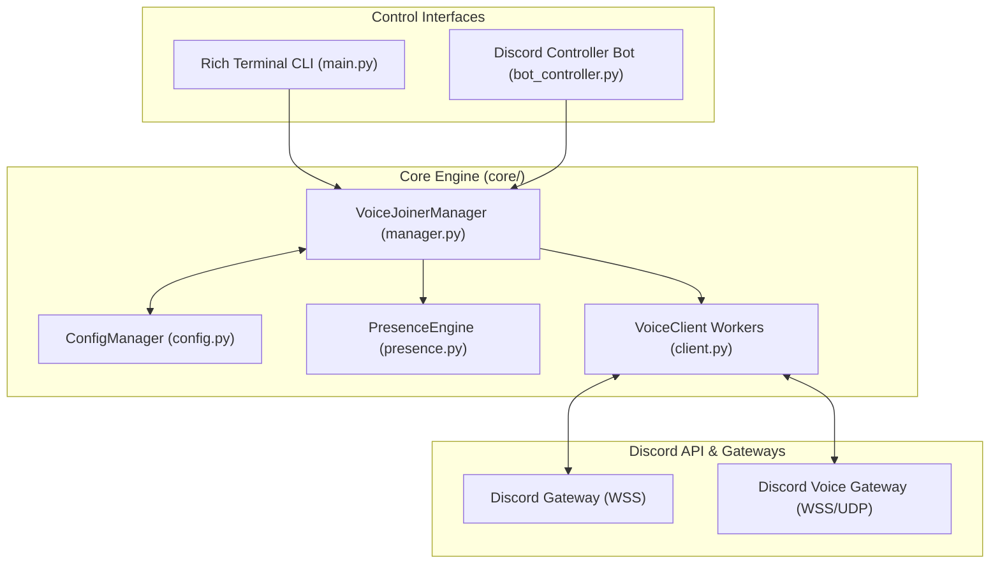

# ╭・VOICE JOINER ╰・Custom Voice Presence Engine

<p align="center">
  
  
  
  
  
</p>

<p align="center">
  A high-performance, asynchronous Discord multi-account Voice Channel automation and Rich Presence management tool built with Python. Manage multiple accounts concurrently with bespoke voice channel sessions, dynamic rich presences (Streaming, Spotify Listening, Playing, Custom Status), and dual-control interfaces (Interactive Rich CLI + Remote Discord Slash Commands).
</p>

---

## 📑 Table of Contents

- [Key Features](#-key-features)
- [Architecture Overview](#-architecture-overview)
- [Requirements & Installation](#-requirements--installation)
- [Configuration](#-configuration)
  - [Account Configuration (`config.json`)](#account-configuration-configjson)
  - [Bulk Import (`tokens.txt`)](#bulk-import-tokenstxt)
- [Interactive CLI Reference](#-interactive-cli-reference)
- [Discord Bot Controller](#-discord-bot-controller)
- [Security & Disclaimer](#-security--disclaimer)
- [Credits](#-credits)
- [License](#-license)

---

## 🌟 Key Features

* **⚡ Concurrent Multi-Account Engine** — Run multiple Discord accounts simultaneously in independent asynchronous worker loops via lightweight WebSocket connections.
* **🔊 Independent Voice Channel Routing** — Each account can join, switch, or leave voice channels independently or synchronously as a group.
* **🎭 Advanced Rich Presence Emulation**:
  * **Streaming** — Display purple live stream badge with custom title and Twitch stream URL.
  * **Spotify / Listening** — Show authentic music presence displaying song name and artist metadata.
  * **Playing** — Display game title, rich details, and state indicators.
  * **Custom Status** — Set customized status text with unicode emoji support.
  * **Status Modes** — Toggle `online`, `idle`, `dnd`, and `invisible` per account.
* **🎙️ Voice State Controls** — Toggle or set self-mute, self-deafen, and video/camera indicators on the fly.
* **🔄 Resilient Auto-Reconnection** — Automatically detects connection drops and voice kicks, rejoining specified channels after configurable backoff delays.
* **🖥️ Beautiful Rich Terminal Interface** — Real-time interactive CLI featuring status tables, formatted log feeds, and intuitive command handling.
* **🤖 Remote Discord Bot Controller** — Control and orchestrate all voice joiner instances remotely from Discord via native Slash Commands (`/vc join`, `/vc stream`, `/vc music`, etc.).
* **💾 Persistent Storage** — Configuration and runtime state are safely serialized to `config.json`.

---

## 🏗️ Architecture Overview



---

## 📦 Requirements & Installation

### Prerequisites

* **Python 3.9 or higher**
* Active internet connection with direct access to Discord Gateways (`gateway.discord.gg`)

### 1. Clone the Repository

```bash
git clone https://github.com/your-username/vc-joiner-recoded.git
cd vc-joiner-recoded
```

### 2. Install Dependencies

Install the required Python libraries using `pip`:

```bash
pip install -r requirements.txt
```

#### Required Packages
* `aiohttp>=3.9.0` — High-performance asynchronous HTTP & WebSocket client.
* `rich>=13.0.0` — Terminal UI styling, tables, panels, and live logging.
* `discord.py>=2.3.0` — Application command framework for the optional bot controller.

---

## ⚙️ Configuration

### Account Configuration (`config.json`)

Configure your accounts and general preferences in `config.json`:

```json
{
    "settings": {
        "auto_rejoin_on_disconnect": true,
        "auto_connect_on_startup": true,
        "reconnect_delay_seconds": 5,
        "log_level": "INFO"
    },
    "controller_bot": {
        "enabled": false,
        "bot_token": "YOUR_DISCORD_BOT_TOKEN",
        "prefix": "!"
    },
    "accounts": [
        {
            "name": "Account 01",
            "token": "USER_TOKEN_HERE",
            "guild_id": "GUILD_ID",
            "channel_id": "CHANNEL_ID",
            "self_mute": false,
            "self_deaf": false,
            "self_video": false,
            "status": "online",
            "activity": {
                "type": "streaming",
                "name": "Valorant",
                "url": "https://www.twitch.tv/valorant",
                "details": "Competitive 5v5",
                "state": "Ranked Match"
            }
        },
        {
            "name": "Account 02",
            "token": "USER_TOKEN_HERE",
            "guild_id": "GUILD_ID",
            "channel_id": "CHANNEL_ID",
            "self_mute": true,
            "self_deaf": true,
            "self_video": false,
            "status": "online",
            "activity": {
                "type": "listening",
                "name": "Spotify",
                "details": "Starboy",
                "state": "The Weeknd"
            }
        }
    ]
}
```

### Bulk Import (`tokens.txt`)

If managing multiple accounts, quickly populate accounts via `tokens.txt`:

```text
# Single line formats supported:
TOKEN
TOKEN:CHANNEL_ID
TOKEN:CHANNEL_ID:GUILD_ID
```

Execute `/vc import` inside the CLI to automatically register all entries.

---

## 🚀 Usage

### 1. Launch the Voice Joiner CLI

```bash
python main.py
```

Upon launching, the interactive Rich terminal dashboard opens, displaying the live account matrix and accepting input commands.

---

## 🎮 Interactive CLI Reference

Commands can be invoked directly with or without the `/vc ` prefix:

| Command | Arguments | Description | Example |
| :--- | :--- | :--- | :--- |
| `join` | `<channel_id> [account]` | Join target voice channel (`all` or account name/index) | `/vc join 123456789 all` |
| `leave` | `[account]` | Leave current voice channel (`all` or account name/index) | `/vc leave 1` |
| `stream` | `<account> <title> [url]` | Set Streaming presence in VC with purple Twitch badge | `/vc stream 1 "Valorant" https://twitch.tv/shroud` |
| `music` | `<account> <song> [artist]` | Set Spotify Listening presence with track info | `/vc music 2 "Starboy" "The Weeknd"` |
| `activity` | `<account> <type> <name> [details] [state]` | Set activity (`playing`, `streaming`, `listening`, `watching`, `custom`, `none`) | `/vc activity 3 playing "Minecraft" "Survival"` |
| `status` | `<account> <status>` | Set account status (`online`, `idle`, `dnd`, `invisible`) | `/vc status 4 idle` |
| `custom` | `<account> <text> [emoji]` | Set custom status text and unicode emoji | `/vc custom 4 "In a private VC" 🎧` |
| `mute` | `<account> [on/off]` | Toggle or set microphone mute state | `/vc mute all on` |
| `deaf` | `<account> [on/off]` | Toggle or set deafen state | `/vc deaf all on` |
| `video` | `<account> [on/off]` | Toggle or set camera / video streaming flag | `/vc video 1 on` |
| `list` | *none* | Render live dashboard table of accounts, voice states, and presence | `/vc list` |
| `add` | `<token> [name]` | Register and start a new account at runtime | `/vc add OTA... "Account 05"` |
| `remove` | `<account>` | Disconnect and remove an account from manager | `/vc remove 3` |
| `import` | *none* | Import accounts from `tokens.txt` | `/vc import` |
| `save` | *none* | Persist current configuration state to `config.json` | `/vc save` |
| `help` | *none* | Display the command help menu | `/vc help` |
| `exit` | *none* | Gracefully disconnect all clients and shutdown | `/vc exit` |

---

## 🤖 Discord Bot Controller

You can control your Voice Joiner instances remotely through a dedicated Discord Bot:

1. Create a Bot application in the [Discord Developer Portal](https://discord.com/developers/applications).
2. Enable `SERVER MEMBERS INTENT` and `MESSAGE CONTENT INTENT` in the bot settings.
3. Invite the bot to your server with `applications.commands` and `bot` permissions.
4. Set `"enabled": true` and insert your bot token into `config.json`:
   ```json
   "controller_bot": {
       "enabled": true,
       "bot_token": "YOUR_DISCORD_BOT_TOKEN",
       "prefix": "!"
   }
   ```
5. Run the bot controller:
   ```bash
   python bot_controller.py
   ```

### Slash Commands Available:
* `/vc join <channel> [account]` — Move accounts to the specified voice channel.
* `/vc leave [account]` — Disconnect accounts from voice channels.
* `/vc stream <account> <title> [twitch_url]` — Update stream title and URL.
* `/vc music <account> <song> [artist]` — Set Spotify listening presence.
* `/vc status <account> <status>` — Update user online status.
* `/vc custom <account> <text> [emoji]` — Update custom status text and emoji.
* `/vc mute <account> [state]` — Toggle self-mute.
* `/vc deaf <account> [state]` — Toggle self-deafen.
* `/vc list` — Return an embed displaying all connected account statuses.

---

## ⚠️ Security & Disclaimer

> [!CAUTION]
> Automating user accounts (Selfbots) is against Discord's Terms of Service and Community Guidelines. Using automated scripts on personal accounts can result in account suspension or termination.
>
> This software is intended strictly for educational, personal research, and testing purposes in controlled environments. The author and contributors are not responsible for any misuse, account penalties, or damages incurred.

* **Never share or commit tokens** — Keep your `config.json` and `tokens.txt` private.
* **Rate Limits** — Avoid spamming connection requests or presence updates to stay within Discord gateway limits.

---

## 👑 Credits

* **Developer:** **Saint**
* **Discord:** **`xqfb`**

---

## 📄 License

This project is licensed under the [MIT License](LICENSE).
